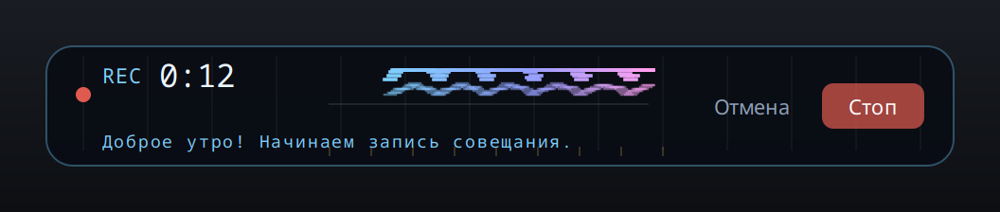
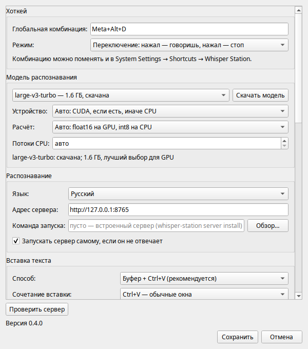

# whisper-station

[English](README.md) | [Русский](README.ru.md)

On-device dictation for KDE Plasma 6 on Wayland: a global hotkey → microphone → local
Whisper model → text into the active window. No cloud, no telemetry: the only network
traffic is `127.0.0.1`.

**Status:** 0.4.0, published as a **CachyOS/Arch + KDE Plasma 6 + Wayland** tool.
Other distributions and GNOME/Hyprland are untested; X11 is not supported.



## Features

- **Global hotkey** through `org.kde.kglobalaccel` with both press and release:
  toggle mode and push-to-talk.
- **HUD** with a waveform, a timer, live preview of the recognition and an `Esc` cancel;
  the window is placed on top by a KWin window rule.
- **Text after recognition**: custom dictionary with fuzzy matching, filler removal,
  stutter collapsing, trailing space. The dictionary is also sent to the model as
  `initial_prompt`.
- **Insertion** through the clipboard and an emulated paste (`ydotool` over `uinput`),
  `Ctrl+V` or `Ctrl+Shift+V` for terminals, optional clipboard restore, `type` and
  `clipboard` modes.
- **Built-in recognition server** (faster-whisper) in a dedicated venv, a catalog of six
  models, CUDA or CPU (`int8`), idle unload. A foreign server on the same port is reused
  and never killed.
- **Tray, settings, autostart, systemd user unit, `doctor`, CLI.**

## Requirements

The primary target is CachyOS/Arch, KDE Plasma 6, Wayland (tested on Plasma 6.8):

- Python 3.12+ with `PySide6`, `dbus-python`, `PyGObject`;
- `pipewire` and `pipewire-audio` (`pw-record`/`pw-play`; `parec` from `libpulse` is a
  fallback), `wl-clipboard`, `libnotify`;
- `ydotool` and access to `/dev/uinput` — for pasting with `Ctrl+V` (on CachyOS the ACL
  is already in place);
- the recognition server is installed by the app itself into a separate environment;
  the model is downloaded on demand. Only these two steps need the network.

Check everything with one command: `bin/whisper-station doctor`.

## Install

### One command

```sh
git clone <repository-url> whisper-station
cd whisper-station
./install.sh
```

The script is idempotent: it installs the dependencies, builds and installs the package,
sets up the server environment (with CUDA when an NVIDIA GPU is present), downloads the
model that fits the device (`large-v3-turbo` for GPU, `small` for CPU), enables autostart
and finally runs `doctor`. Preview without touching anything: `./install.sh --dry-run`.
Options: `--cpu`, `--model medium`, `--no-autostart`, `-y`.

### Manual

```sh
# dependencies (if not installed yet)
sudo pacman -S --needed pyside6 python-dbus python-gobject pipewire wl-clipboard libnotify ydotool

makepkg -sf                      # build; -s installs missing dependencies
sudo pacman -U whisper-station-*.pkg.tar.zst
```

The package puts the code into `/usr/lib/whisper-station`, the wrapper into
`/usr/bin/whisper-station`, the `.desktop` file and the icon into `/usr/share`.
Then the server and the model:

```sh
whisper-station server install                     # venv + faster-whisper, ~2 minutes
# for NVIDIA add the CUDA libraries (otherwise CPU is used):
whisper-station server install --cuda              # ~1.4 GB of cuBLAS/cuDNN wheels
whisper-station model download --name small --yes   # 0.5 GB; for GPU — large-v3-turbo
whisper-station doctor
whisper-station                                     # the daemon (tray)
whisper-station autostart on                        # start at login
```

The model does not have to be downloaded in advance: the server downloads it on the first
recognition. The explicit command exists so that you see the progress and pick the size
deliberately.

## Usage

1. Start `whisper-station` (tray) — or enable autostart in the settings.
2. Press `Meta+Alt+D`, speak, press it again. A compact HUD with a waveform and a timer
   appears.
3. The text is recognized and inserted into the active window (clipboard + `Ctrl+V`).
4. `Esc` in the HUD cancels without insertion; the "Стоп"/"Отмена" buttons do the same.

Two hotkey modes (settings → "Хоткей" → "Режим"):

- **Toggle** (default): press — speak — press again to stop and insert.
- **Push-to-talk**: hold the key while speaking, release to stop and insert. A release
  shorter than 0.35 s is treated as an accidental tap and simply cancels.

Live preview (on by default): while recording, the recognized text scrolls through the HUD,
but only the final text goes into the window. Turn it off in the settings or with
`[preview] live = false`.

In terminals use **Ctrl+Shift+V** instead of `Ctrl+V`: switch "Сочетание вставки" in the
settings when dictating into a console. The clipboard is **not** restored by default, so
if the insertion failed the dictated text stays in the clipboard and can be pasted manually.

If the server is not running, the app starts its own (`server install` → venv), waits for
`/health` and stops it on exit. A foreign server on the port is never killed and is reused.

## Model and server

Model and device are chosen in settings → "Модель распознавания" or in the config:

```toml
[model]
name = "small"     # tiny, base, small, medium, large-v3-turbo, large-v3
device = "auto"    # auto: CUDA when visible, otherwise CPU
compute = "auto"   # auto: float16 on GPU, int8 on CPU
threads = 0        # 0 — automatic (cores minus two)
```

| Model | Size | For whom |
|---|---|---|
| `tiny` | 75 MB | drafts, weak laptops |
| `base` | 145 MB | simple speech |
| `small` | 0.5 GB | **default for CPU** |
| `medium` | 1.5 GB | strong CPU, better quality |
| `large-v3-turbo` | 1.6 GB | **default for GPU** |
| `large-v3` | 3.1 GB | maximum quality, needs memory |

Everything works without NVIDIA, but on CPU: `ctranslate2` does not support Intel/AMD GPUs,
so `device = "auto"` gives CPU + `int8`. Measured on 10 threads (2.4 s of speech): `small`
— ~1.0 s, `large-v3-turbo` — ~3.6 s, i.e. the big model is slower than real time on CPU.
Use `small` or `medium`. On an RTX 3060 (`float16`) the same phrase takes **276 ms**.

NVIDIA needs cuBLAS and cuDNN 12/9, which usually are not installed system-wide, so
`server install --cuda` puts the NVIDIA wheels into the venv. If they are missing the
server does not crash: it warms the model up on start, falls back to CPU and reports the
reason in `/health` (`fallback`).

The server lives in `~/.local/share/whisper-station/server-venv`:

```sh
whisper-station server install|status|start|uninstall
whisper-station model list|status|download|remove
```

`/health` shows the loaded model and device; the server unloads itself after 30 minutes of
idle time (`WHISPER_IDLE_SECONDS`). A custom server is still supported: if it already
listens on the port the app uses it, and its own start command can be set in
`[transcribe] server_command`.

## Settings

`~/.config/whisper-station/config.toml` or the "Настройки…" window in the tray: hotkey,
model and device, language, server address and command, insertion mode
(`paste`/`type`/`clipboard`), clipboard restore, dictionary and text cleanup, autostart,
sound, recording limits. The dictionary is sent to the model as `prompt` (up to 20 terms)
and additionally corrects the text after recognition.

The hotkey is also visible in System Settings → Shortcuts → Whisper Station and can be
changed there. A fallback for any session: bind a key to `whisper-station toggle`.



## Commands

`toggle`, `start`, `stop`, `cancel`, `repaste`, `settings`, `status`, `transcribe FILE`,
`doctor`, `config`, `log`, `autostart on|off`, `server install|status|start|uninstall`,
`model list|status|download|remove`, `systemd install|enable|disable|status`,
`service status|start`, `quit`, `daemon`.

- `repaste` and the tray item "Вставить последний текст" re-insert the last dictation.
- `server install` sets up the server environment (venv + faster-whisper), `model download`
  fetches a model from HuggingFace; both ask for confirmation (`--yes`).
- `systemd enable` runs the app through a user unit with restart; autostart is disabled then.
- Recording limit: 5 minutes by default, 30 maximum (`[audio] max_seconds`).

## Limitations (honest)

- This is a KDE application for now: the hotkey goes through `org.kde.kglobalaccel`
  (verified on Plasma 6.8 / KWin); the XDG `GlobalShortcuts` portal is not used. On
  GNOME/Hyprland bind `whisper-station toggle` to a key manually — the rest works.
- X11 is not supported: recording and insertion are built on PipeWire and `wl-copy`.
- GPU only NVIDIA: `ctranslate2` has no Intel/AMD support, those machines use CPU.
- The HUD takes focus while recording (KWin does not deliver the keyboard to an unfocused
  window, otherwise `Esc` and the buttons would not work). Before insertion the HUD hides
  and focus returns to the target window.
- The HUD position is set by the KWin rule "Whisper Station HUD" (top center): Wayland
  does not let a client move its windows. The rule is visible and removable in System
  Settings → Window Rules; it can be turned off in the app settings.
- Recording goes through `pw-record`: `parec` does not deliver data to a pipe on PipeWire,
  so it is kept only as a fallback.
- Short hotkey presses (<0.25 s) and silence are not errors and show no notifications; a
  recording below the silence threshold is not sent to the model, and typical Whisper
  "subtitles/music" hallucinations are filtered out.
- Clipboard restore is delayed by 1.5 s: Wayland delivers the pasted data asynchronously.
- The tray is a StatusNotifierItem implemented with Qt; it works on KDE without
  `libayatana-appindicator`.

## Uninstall

```sh
whisper-station server uninstall --yes     # server environment
sudo pacman -R whisper-station
rm -rf ~/.config/whisper-station ~/.local/state/whisper-station ~/.local/share/whisper-station
```

Settings from the pre-0.3 versions live in `~/.config/whisper-dictate` and are migrated on
start; delete that directory too if you want a clean state.

## Brand and docs

The icon and palette live in `brand/`: the master `brand/app.svg`, exports, tray icons for
light and dark panels, the contact sheet `brand/board.png` and `brand/style-tile.html`.
Character, typography, HUD rules and the interface voice are described in
[docs/DESIGN.md](docs/DESIGN.md) (Russian). Rebuild with `python3 brand/make_board.py`.

Architecture and decisions — [docs/ARCHITECTURE.md](docs/ARCHITECTURE.md),
[docs/DECISIONS.md](docs/DECISIONS.md), checks — [docs/VERIFICATION.md](docs/VERIFICATION.md),
plan — [docs/ROADMAP.md](docs/ROADMAP.md), the Handy breakdown —
[docs/HANDY-ANALYSIS.md](docs/HANDY-ANALYSIS.md), publishing —
[docs/RELEASE.md](docs/RELEASE.md), contributing — [CONTRIBUTING.md](CONTRIBUTING.md).
Deep design documents are kept in Russian for now.

License: **GNU GPL v3** (`LICENSE`).
