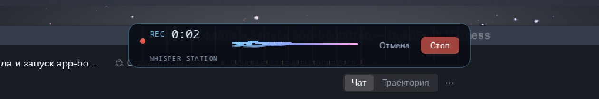

# whisper-station

Локальная диктовка для KDE Plasma 6 / Wayland: глобальный хоткей → запись микрофона →
распознавание локальной моделью Whisper → текст в активном окне. Без облака и телеметрии:
сеть только на `127.0.0.1`.

*Local dictation for KDE Plasma 6 on Wayland: a global hotkey, on-device Whisper,
text into the active window. No cloud, loopback only. Tested on CachyOS/Arch only.*

**Статус:** 0.4.0, публикуется как инструмент для **CachyOS/Arch + KDE Plasma 6 + Wayland**.
Другие дистрибутивы и GNOME/Hyprland не проверялись; X11 не поддерживается.



## Что нужно

Основной сценарий — CachyOS/Arch, KDE Plasma 6, Wayland (проверено на Plasma 6.8):

- Python 3.12+ с `PySide6`, `dbus-python`, `PyGObject` (`pyside6 python-dbus python-gobject`);
- `pipewire` (`pw-record`; `parec` — запасной вариант), `wl-clipboard`, `libnotify`;
- `ydotool` и доступ к `/dev/uinput` — для вставки через Ctrl+V (на CachyOS ACL уже есть);
- сервер распознавания: приложение ставит его само в отдельное окружение
  (`whisper-station server install`), модель качается командой `whisper-station model download`.
  Интернет нужен только этим двум командам.

Готовность проверить одной командой: `bin/whisper-station doctor`.

## Запуск из репозитория

```sh
make test        # юнит-тесты (unittest, без внешних пакетов)
make lint        # мини-линтер (синтаксис, стиль, импорты)
make run         # демон с иконкой в трее (передний план)
make doctor      # проверка окружения: хоткей, вставка, сервер
```

Второй экземпляр не запускается: демон держит UNIX-сокет в `$XDG_RUNTIME_DIR`.

> Приложение раньше называлось `whisper-dictate`. Настройки из
> `~/.config/whisper-dictate/config.toml` переносятся автоматически при первом запуске.

## Установка

### Одной командой

```sh
git clone <адрес репозитория> whisper-station
cd whisper-station
./install.sh
```

Скрипт идемпотентен: ставит зависимости, собирает и устанавливает пакет, ставит
окружение сервера (с CUDA, если есть NVIDIA), скачивает подходящую модель
(`large-v3-turbo` для GPU, `small` для CPU), включает автозапуск и в конце запускает
`doctor`. Ничего не меняя, посмотреть план: `./install.sh --dry-run`. Варианты:
`--cpu` (без CUDA), `--model medium`, `--no-autostart`, `-y` (не спрашивать).

### Вручную

```sh
# зависимости (если ещё не стоят)
sudo pacman -S --needed pyside6 python-dbus python-gobject pipewire wl-clipboard libnotify ydotool

makepkg -sf                      # собрать; -s доставит недостающие зависимости
sudo pacman -U whisper-station-*.pkg.tar.zst
```

Пакет кладёт код в `/usr/lib/whisper-station`, обёртку — в `/usr/bin/whisper-station`,
`.desktop` и иконку — в `/usr/share`. Дальше — сервер и модель:

```sh
whisper-station server install                     # venv + faster-whisper, ~2 минуты
# для NVIDIA добавьте CUDA-библиотеки (иначе будет CPU):
whisper-station server install --cuda              # ~1.4 ГБ колёс cuBLAS/cuDNN
whisper-station model download --name small --yes   # 0.5 ГБ; для GPU — large-v3-turbo
whisper-station doctor
whisper-station                                     # демон (трей)
whisper-station autostart on                        # автозапуск при входе
```

Модель можно не качать заранее: при первом распознавании сервер скачает её сам.
Отдельная команда нужна, чтобы видеть прогресс и выбрать размер осознанно.

Автозапуск пишет `~/.config/autostart/whisper-station.desktop`
(`Exec=/usr/bin/whisper-station daemon`).

## Как пользоваться

1. Запустите `whisper-station` (трей) — или включите автозапуск в настройках.
2. Нажмите `Meta+Alt+D`, говорите, нажмите ещё раз. Появится компактный HUD
   с осциллограммой голоса и таймером.
3. Текст распознаётся и вставляется в активное окно (буфер + Ctrl+V).
4. `Esc` в HUD — отмена без вставки; кнопки «Стоп»/«Отмена» делают то же самое.

Два режима хоткея (настройки → «Хоткей» → «Режим»):

- **Переключение** (по умолчанию): нажал — говоришь, нажал — стоп и вставка.
- **Удержание** (push-to-talk): держишь клавишу, пока говоришь, отпускаешь — стоп и вставка.
  Отпускание короче 0.35 с считается случайным тапом и просто отменяется.

В конфиге: `[hotkey] mode = "toggle"` или `mode = "press"`.

Живой предпросмотр (включён по умолчанию): пока идёт запись, распознанный текст
бегущей строкой показывается в HUD, но в окно попадает только после остановки.
Выключить — галочка в настройках или `[preview] live = false`.

Словарь и чистка текста: в настройках → «Словарь и текст» добавьте свои термины и
имена — похожие слова исправляются после распознавания (нечёткое совпадение,
порог 0.18). Там же убираются филлеры «ээ/ммм/uh/hmm», схлопываются повторы
«я я я» и включается пробел в конце вставки. Сервер Whisper подсказки не принимает,
поэтому словарь — пост-коррекция. В конфиге: `[dictionary] words = [...]`,
`threshold = 0.18`; `[text] remove_fillers`, `collapse_stutters`, `trailing_space`,
`fillers` (свой список заменяет встроенный).

В терминалах вставка — **Ctrl+Shift+V**, а не Ctrl+V: переключите «Сочетание вставки»
в настройках, когда диктуете в консоль. Буфер по умолчанию **не восстанавливается**,
поэтому если вставка не сработала, продиктованный текст остаётся в буфере — его можно
вставить вручную.

Если сервер не запущен, приложение поднимет свой (`server install` → venv), дождётся
`/health` и погасит его при выходе. Чужой сервер на порту не убивается и переиспользуется.

## Модель и сервер

Модель и устройство выбираются в настройках → «Модель распознавания» или в конфиге:

```toml
[model]
name = "small"     # tiny, base, small, medium, large-v3-turbo, large-v3
device = "auto"    # auto: CUDA, если видна, иначе CPU
compute = "auto"   # auto: float16 на GPU, int8 на CPU
threads = 0        # 0 — авто (ядра минус два)
```

| Модель | Размер | Для кого |
|---|---|---|
| `tiny` | 75 МБ | черновики, слабый ноутбук |
| `base` | 145 МБ | простая речь |
| `small` | 0.5 ГБ | **по умолчанию для CPU** |
| `medium` | 1.5 ГБ | сильный CPU, качество выше |
| `large-v3-turbo` | 1.6 ГБ | **по умолчанию для GPU** |
| `large-v3` | 3.1 ГБ | максимум качества, нужна память |

Без NVIDIA всё работает, но на CPU: `ctranslate2` не умеет Intel/AMD GPU, поэтому
`device = "auto"` даёт CPU + `int8`. Замер на 10 потоках (2.4 с речи): `small` — ~1.0 с,
`large-v3-turbo` — ~3.6 с, то есть на CPU большая модель считается медленнее
реального времени. Берите `small` или `medium`. Смена модели в настройках
перезапускает сервер (модель читается только при старте).

Для NVIDIA серверу нужны cuBLAS и cuDNN версии 12/9 — системных обычно нет, поэтому
`server install --cuda` доставляет их колёсами NVIDIA в venv. Если библиотек нет,
сервер не падает: при старте делает пробный прогон, уходит на CPU и пишет причину
в `/health` (`fallback`). Замер на RTX 3060: 311 мс на 2.4 с речи (float16).

Сервер — свой, в `~/.local/share/whisper-station/server-venv`:

```sh
whisper-station server install|status|start|uninstall
whisper-station model list|status|download|remove
```

`/health` показывает загруженную модель и устройство, сервер сам выгружается после
30 минут простоя (`WHISPER_IDLE_SECONDS`). Чужой сервер по-прежнему поддерживается:
если он уже слушает порт, приложение его использует и не убивает, а свою команду
запуска можно задать в `[transcribe] server_command`.

## Настройки

`~/.config/whisper-station/config.toml` или окно «Настройки…» в трее: хоткей, модель и
устройство, язык, адрес и команда сервера, способ вставки (`paste`/`type`/`clipboard`),
восстановление буфера, словарь терминов и чистка текста, автозапуск, звуковой сигнал,
длительности записи. Словарь уходит в модель как `prompt` (до 20 терминов) и дополнительно
правит текст после распознавания.

Хоткей также виден в System Settings → Shortcuts → Whisper Station: менять можно там.
Резервный вариант для любой сессии — назначить сочетание на команду `whisper-station toggle`.

## Команды

`toggle`, `start`, `stop`, `cancel`, `repaste`, `settings`, `status`, `transcribe FILE`,
`doctor`, `config`, `log`, `autostart on|off`, `server install|status|start|uninstall`,
`model list|status|download|remove`, `systemd install|enable|disable|status`,
`service status|start`, `quit`, `daemon`.

- `repaste` и пункт трея «Вставить последний текст» — повторная вставка последней диктовки.
- `server install` — окружение сервера (venv + faster-whisper), `model download` — модель
  из HuggingFace; обе команды спрашивают подтверждение (`--yes`).
- `systemd enable` — запуск через user-юнит с автоперезапуском; autostart при этом отключается.
- Длительность записи: по умолчанию 5 минут, максимум 30 (`[audio] max_seconds`).

## Ограничения (честно)

- Пока это KDE-приложение: хоткей работает через `org.kde.kglobalaccel` — проверено на
  Plasma 6.8 (KWin), XDG-портал `GlobalShortcuts` не используется. На GNOME/Hyprland
  назначьте `whisper-station toggle` на клавишу вручную — остальное заработает.
- X11 не поддерживается: запись и вставка построены на PipeWire и `wl-copy`.
- GPU только NVIDIA: `ctranslate2` не поддерживает Intel/AMD, там будет CPU.
- HUD на время записи забирает фокус (KWin не даёт клавиатуру окну без фокуса, иначе
  не работают Esc и кнопки). Перед вставкой HUD прячется, фокус возвращается в окно.
- Позиция HUD задаётся правилом KWin «Whisper Station HUD» (верх экрана по центру):
  Wayland не позволяет клиенту двигать окна. Правило видно и удаляется в
  System Settings → Window Rules; отключается галочкой в настройках приложения.
- Запись идёт через `pw-record`: `parec` на PipeWire не отдаёт данные, если stdout — pipe
  (в файл пишет нормально), поэтому он оставлен только как запасной вариант.
- Короткое нажатие хоткея (меньше 0.25 с) и тишина не считаются ошибкой и не показывают
  уведомлений — только реальные сбои. Запись ниже порога тишины не отправляется в модель,
  а типовые «субтитры/музыка» от Whisper отфильтровываются.
- Восстановление буфера отложено на 1.5 с: Wayland отдаёт данные вставки асинхронно.
- Трей — StatusNotifierItem средствами Qt; на KDE работает без `libayatana-appindicator`.

## Удаление

```sh
whisper-station server uninstall --yes     # окружение сервера
sudo pacman -R whisper-station
rm -rf ~/.config/whisper-station ~/.local/state/whisper-station ~/.local/share/whisper-station
```

## Бренд

Иконка и палитра — в `brand/`: мастер `brand/app.svg`, экспорты, трей для светлой
и тёмной панели, контактный лист `brand/board.png` и `brand/style-tile.html`.
Характер, типографика, правила HUD и голос интерфейса — [docs/DESIGN.md](docs/DESIGN.md).
Пересобрать: `python3 brand/make_board.py`. Иконка пакета совпадает с бренд-мастером
(это проверяет тест).

Лицензия: **GNU GPL v3** (`LICENSE`).

Архитектура и решения — [docs/ARCHITECTURE.md](docs/ARCHITECTURE.md), [docs/DECISIONS.md](docs/DECISIONS.md), проверки — [docs/VERIFICATION.md](docs/VERIFICATION.md), план — [docs/ROADMAP.md](docs/ROADMAP.md), разбор Handy — [docs/HANDY-ANALYSIS.md](docs/HANDY-ANALYSIS.md), публикация — [docs/RELEASE.md](docs/RELEASE.md), вклад — [CONTRIBUTING.md](CONTRIBUTING.md).

Схема архитектуры (интерактивный HTML, генерируется Archify из `candidate.json`):
`.archify/architecture-whisper-station-20261107-194924/whisper-station.html`.
